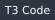
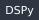
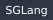

I lead agentic development and AI for **NVIDIA Developer Programs**.

I started in robotics and computer vision, getting machines to see and act. That grew into GPU video pipelines, physical AI and vision-language models on Jetson and DGX. Now I build agents, the frameworks under them and the inference behind them. Most of that code is internal to NVIDIA, so this page is the summary.

I love developer tools, local AI and open source.

### Now

- **Coding agents:** Claude Code, Codex, Cursor and Devin, usually all at once, orchestrated from T3 Code. Each gets its own worktree and the right model for the job, and nothing merges until I approve it. The skills, hooks and plugins they run on are mine.
- **Building agents:** typed agents with Pydantic AI and DSPy, prompts tuned with GEPA, tools over MCP, and a self-improving agent framework in Rust.
- **Physical AI:** DeepStream pipelines feeding vision-language models (Nemotron, Cosmos) and multi-view 3D tracking, measured on Jetson, DGX Spark and discrete GPUs.
- **Inference:** vLLM, SGLang and TensorRT-LLM, tuned for time to first token.
- **Local AI:** my house has its own agent, built on the open-source Hermes Agent. It runs on a Jetson AGX Orin next to Home Assistant, Scrypted, Whisper and Kokoro, and thinks with an open-weight Qwen model served from a GB10 box on the LAN.

### Stack

<p>
  
  
  
  
  
  
  
  
  
  
  
  
  
  
  
  
  
  
  
  
  
  
</p>

```text
$ guy --stack
devtools    t3-code  claude-code  codex  cursor  devin
agents      pydantic-ai  dspy  gepa  mcp  litellm
vision      deepstream  tensorrt  triton  jetson  cupy  opencv
inference   vllm  sglang  tensorrt-llm  nim  llama.cpp
homelab     hermes-agent  home-assistant  scrypted  whisper  kokoro  qwen
core        python  rust  c++  cuda  pytorch
infra       aws  terraform  docker  kubernetes  gitlab-ci
```

### Fun facts

- Agents write most of my code. I review all of it.
- I'd rather delete a part than add one.
- I lift heavy things. 🏋🏻

<p align="center"><samp><a href="https://www.linkedin.com/in/guy-da/">linkedin</a> · <a href="https://x.com/DahanGuyda">x</a></samp></p>
